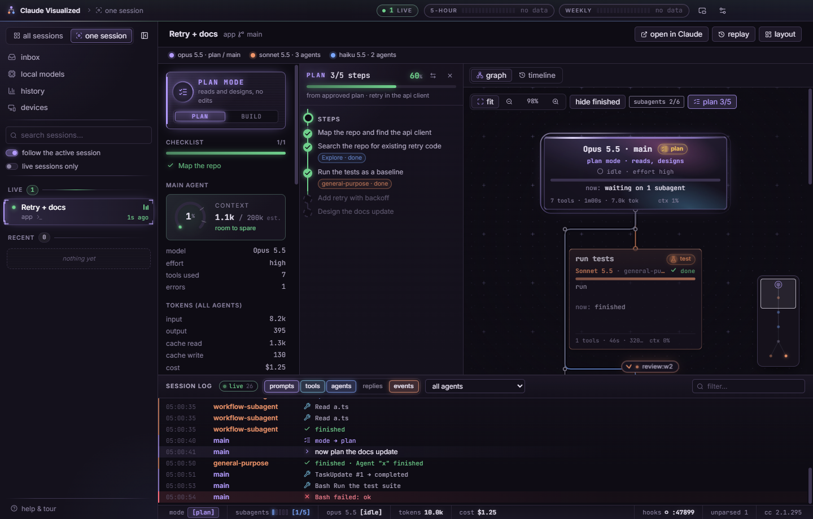
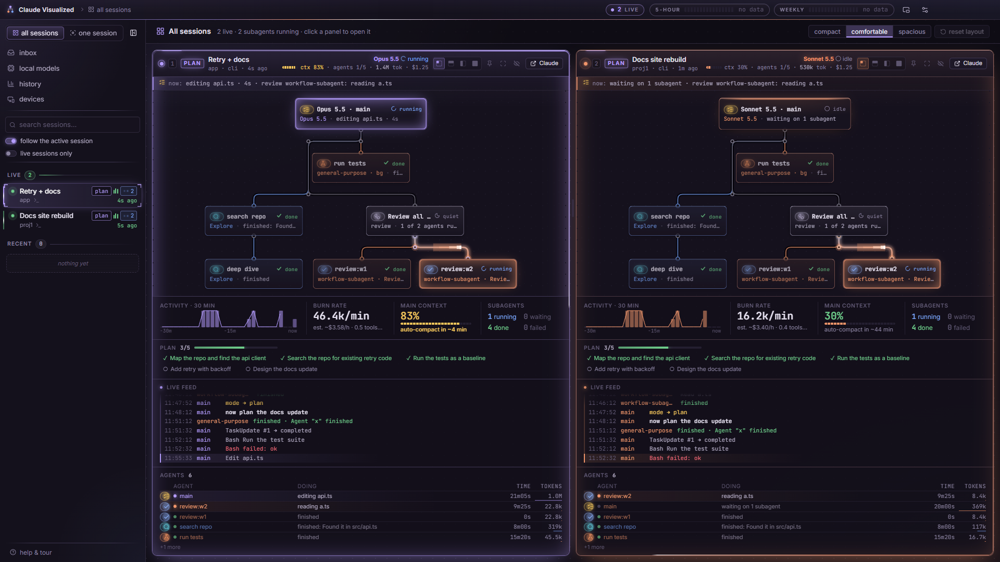
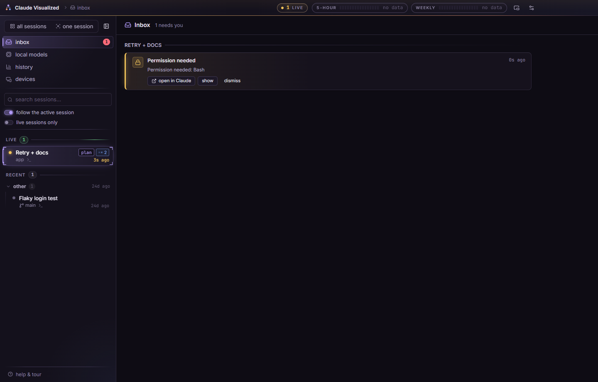
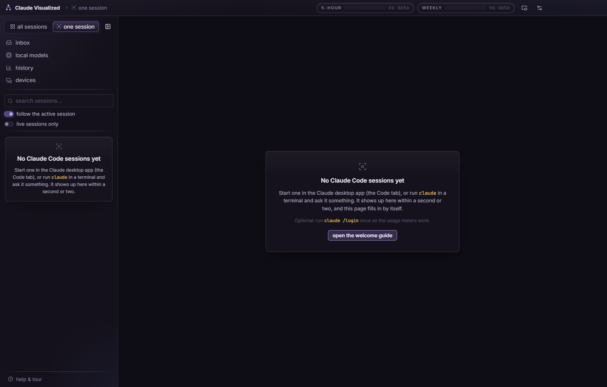

# Claude Visualized

Claude Visualized is a desktop app for Windows and macOS that shows what your Claude Code sessions are doing while they run. Every main agent and subagent becomes a card in a live graph, with its model, status, current tool and token use; beside it you get the plan Claude is following, the session log, your usage meters and an inbox of anything that is waiting for you. It reads the transcripts Claude Code already writes on your computer, so you keep working the way you already do.

## Screenshots









The images live in [docs/images/](docs/images/), which lists the screenshots still to be added.

## Install

### Windows

1. Open the [Releases page](https://github.com/fatty8me2/claude-visualized/releases) and download the installer `.exe` from the latest release. Its file name ends in `Setup-<version>.exe`.
2. Run it. It installs for your user only (no administrator password) and adds Claude Visualized to the Start menu.
3. Windows SmartScreen may say it protected your PC, because the installer is not code-signed yet. Click **More info**, then **Run anyway**.

### macOS

The Mac build is not signed or notarized yet, so macOS blocks it the first time. Either:

- open the `.dmg` from the release, drag **Claude Visualized** to **Applications**, then right-click it and choose **Open** the first time (or run `xattr -dr com.apple.quarantine "/Applications/Claude Visualized.app"` in a terminal), or
- build it yourself from source (see [Build from source](#build-from-source)). [docs/MAC.md](docs/MAC.md) has the steps.

## First launch

The first time you open Claude Visualized, a welcome screen shows a checklist of what it found on this computer:

- **Claude Code data**: whether it found your Claude Code transcripts (`~/.claude/projects`) and how many sessions they hold. If there are none yet, start one: open the **Code** tab in the Claude desktop app, or run `claude` in a terminal. It appears within a second or two.
- **Usage meters**: the 5-hour and weekly limits, read with the login Claude Code already saved on this computer. If it says login is needed, run `claude /login` once in a terminal.
- **Live hooks** (optional): without them the app reads the transcripts, about a second behind. Installing hooks makes updates instant. The hooks dialog shows exactly what it will change before it writes anything.
- **Mini view**: a small always-on-top window with the current mode and running agents.

Take the tour from the welcome screen, or reopen it any time with **help & tour** at the bottom of the sidebar. Nothing leaves your machine except the calls listed in [docs/PRIVACY.md](docs/PRIVACY.md).

## Privacy

- **Read**: your Claude Code transcripts in `~/.claude/projects`, which the app never modifies. It also uses the Claude Code login saved on this computer, only to ask Anthropic for your usage numbers.
- **Written**: the app's own settings, usage reading and history index, kept in its profile folder (`%APPDATA%\Claude Visualized` on Windows). `~/.claude/settings.json` changes only when you click install or remove hooks, after you have seen the preview, and a backup is written first. The app also renews Claude Code's saved login when its token is about to expire, which is what the CLI does too.
- **Sent over the network**: Anthropic's usage endpoint and its login-renewal endpoint (both with your own login), and GitHub for update checks. Local model servers on this computer are polled. The source has no analytics or telemetry.
- **Peer link**: off by default. Only after you tick **Share with my other computers** does it listen for a paired viewer, and then the traffic is encrypted.

The full list of files and network calls, with the conditions for each, is in [docs/PRIVACY.md](docs/PRIVACY.md).

## Sync with Google Drive

**Settings > Sync** keeps your layouts and preferences the same on all your computers. It uses the folder that Google Drive for desktop already syncs (or any folder you choose, such as Dropbox or OneDrive), so the app has no Google sign-in and no network code for it. If Drive for desktop is not installed, the Sync section links to the download and has a **Check again** button.

- **Synced** (into `<Drive>/Claude Visualized/`): panel layout, overview grid and density, plan rail, graph view options, pinned and hidden sessions, collapsed sections, and a few switches (notifications, follow active session, mini view on top, auto-update).
- **Never synced**: anything in `~/.claude`, your Claude login, the peer-link key and paired computers, the history database, the hook port, window position, local model server addresses, and this computer's name. The synced keys are an explicit allowlist, covered by a unit test.
- The newest change to each setting wins. If Drive already has settings when you turn sync on, you choose between Drive's settings, this computer's, or a merge. Turning sync off leaves the files in Drive. If the folder is unavailable (Drive not running), the app keeps working and syncs again when it returns.

## Uninstall hooks

1. Click **Hooks and settings** (the button in the title bar).
2. Under hooks, click **Remove hooks…**, check the preview, then click **Remove hooks from settings.json**.

This removes only the entries the app added (your own hooks stay), deletes the status-line script it wrote, and keeps a backup of `settings.json` in the app's `backups` folder. To remove the app itself, uninstall it like any other program. Its profile folder may stay behind; delete it too if you want all of its data gone.

## Troubleshooting

**No sessions show up.** Claude Code writes its transcripts to `%USERPROFILE%\.claude\projects` (on macOS, `~/.claude/projects`). Check that the folder exists and that a session has run. If Claude Code keeps its data somewhere else, set `CLAUDE_CONFIG_DIR`. In the sidebar, the **live sessions only** box hides sessions that are more than about ten minutes old, and the search box filters the list, so check both.

**The usage meters say not signed in or login needed.** The meters read the login Claude Code saves on this computer. Run `claude` once and sign in (`claude /login`); after that the app keeps the login fresh. The meters need a subscription login: if you only use an API key (for example `ANTHROPIC_API_KEY`), there is no such login to read, so the meters stay empty. Hooks and the session views work either way.

**"port 47821 is in use".** Another program already listens on the hook port. The app still reads the transcripts, but updates are not instant. Close the other program, or pick another port in `config.json` (in the profile folder) or with the `CLAUDE_VIS_PORT` environment variable, then reinstall the hooks.

**The mini-view hotkey does nothing.** Another app may own that shortcut. Settings shows the error, and the previous hotkey keeps working. Pick another one there.

**A session shows "unparsed" lines in the status bar.** Claude Code's transcript format is internal and changes between versions. The app counts the lines it does not understand instead of failing; the rest of the session still shows.

**Local models show nothing.** The local models view only sees servers listening on this computer (Ollama on port 11434, LM Studio on port 1234) or endpoints you add in its settings.

## Build from source

You need Node.js 24 and git.

```bash
git clone https://github.com/fatty8me2/claude-visualized.git
cd claude-visualized
npm ci
npm run dev          # run the app with hot reload
npm run dist:win     # Windows installer in release/<version>/
npm run dist:mac     # macOS disk images in release/<version>/ (run this on a Mac)
```

`npm ci` also downloads the Electron binary. The `dist:*` scripts build only; they never publish. Checks: `npm run check` (typecheck, lint, unit tests) and `npm run test:e2e` (the Playwright suite). The developer reference below has the full script list and the code layout.

## Technical reference

The rest of this page is the detailed reference: what the app shows, how it reads data, and the developer notes.

### What it shows

A desktop app (Windows + macOS) that shows what your Claude Code sessions are doing, live:

- **Agent graph**: the main agent, every subagent it spawns (including nested agents, background agents and
  workflow agents), each titled by its task, with its model, status, current tool, elapsed time, token use and an activity sparkline.
  Hold Ctrl and scroll (or pinch) to zoom around the pointer, drag empty space to pan, or use the fit / − / % / + buttons. Full cards are
  never shrunk below a readable size: the layout wraps into as many columns as the panel is wide (`columnsForWidth`), so a wide tree grows downward instead of scrolling sideways.
  "hide finished" folds finished agents into a chip (a graph setting, remembered); open a chip to see them and fold them back with the
  fold button on their parent. Click empty space or press Esc to close an agent's details.
- **All sessions overview**: resizable panels (1x1 to 2x2, maximize, reorder, pin, hide, three densities). Each panel picks its content from its measured size (`src/core/panelContent.ts`): small panels (and compact density) show the graph and a 2-line log; medium panels add an insight rail (30-minute activity sparkline, tokens/min and est. $/h, main context with "auto-compact in ~N min", running/waiting/done/failed counts); large panels, including maximized, add the live feed, a plan strip (only when the session has a plan) and an agent table (running first). Rates refresh every 15 s.
- **Mode panel**: PLAN vs BUILD (and the exact permission mode), the session's task checklist, token totals and the
  cost Claude Code reports. When Claude Code reported no cost, an estimate at Anthropic API list prices is shown instead, marked
  "est." with a tooltip (prices in `src/core/pricing.ts`, `PRICES_AS_OF`). Subscription plans are not billed per token, so the estimate is a
  yardstick, not a bill. History shows the same estimate for all tokens in the range next to the reported total.
- **Plan rail**: when the session has a plan (plan mode's plan file or the approved `ExitPlanMode` plan, else its todo list) it is drawn as a metro line beside the agent graph: sections are stations, steps are nodes (done / in progress / pending) and the agents doing each step hang under it as chips. A step counts as done or in progress only on evidence: a ticked `[x]`, a matching todo, or a matching agent (keyword overlap with the agent's description). Hover a step to light up its agents in the graph, hover an agent to light up its step. Toggle it with **plan** in the graph toolbar, drag its edge to resize, and flip it to the other side with the arrows button.
- **Session log**: timestamped prompts, tool calls, spawns, completions, mode changes and replies, filterable by agent and kind.
  Failed tool calls carry the first line of what they said; the agent details show the full message (up to 300 characters).
- **Session picker**: every session under `~/.claude/projects`, live ones first, then recent ones grouped by project (collapsible),
  with an option to follow whichever session is active right now. Search matches title, project, folder, git branch and machine.
  Right-click a session (or use its "…" button) to pin it to the top, hide it, open it in Claude or copy its id or folder.
- **Tray icon + mini view**: a small always-on-top window with the mode, the main agent's current tool and the running subagents.
- **Replay**: scrub or play back any past session at 1–128×.
- **Inbox** (sidebar, with an unread badge): one list of everything that needs you across all sessions: permission prompts and "needs your input" (hooks), finished turns awaiting a reply, failed agents and bursts of failed tool calls (grouped), API errors, and the 5-hour / weekly limit at 90% or more. Items resolve themselves (a newer prompt, the agent resuming, usage dropping) or you dismiss them; dismissals are stored in the app's profile (`inbox-dismissed.json`). The derivation is `src/core/inbox.ts`; the tray menu/tooltip show "N need you" with a dot on the tray icon and a taskbar overlay, and the mini view shows a one-line count. Read-only: actions only jump to the chat in the Claude app.
- **Notifications** when a session needs your input (with hooks) or, optionally, when a subagent finishes.

It works with both the Claude desktop app's Code tab and the `claude` CLI, because both write the same transcripts.

### Local models

Claude Code can run against local models through a gateway or proxy (LiteLLM, Ollama's Anthropic-compatible endpoint, claude-code-router, LM Studio, ...) via `ANTHROPIC_BASE_URL` / `ANTHROPIC_MODEL`. The transcripts then carry non-Claude model ids such as `qwen2.5-coder:32b` or `ollama/llama3.1:70b`.

- **Recognition** (`src/core/models.ts`): model ids are classified as `anthropic`, `local` (qwen, llama, mistral/mixtral/codestral/devstral, deepseek, gemma, phi, gpt-oss, granite, starcoder, codellama, command-r, glm, kimi, or any `ollama/`, `lmstudio-community/`, `hf.co/` id) or `other` (hosted gateways such as `openrouter/...`, `gpt-4o`). Labels are prettified (`qwen2.5-coder:32b` becomes "Qwen2.5 Coder 32B"). Local agents get a teal colour (`--local`), a "local" tag on cards, legend, overview panels and the mini view, and their tokens are shown as "local tokens", separate from Claude's. They are never attributed to the 5-hour / weekly meters.
- **Context**: a local agent shows a context percentage only when a running server reported the model's context length (Ollama `/api/ps` `context_length`, `/api/show` `num_ctx` or `model_info.*.context_length`, LM Studio `loaded_context_length` / `max_context_length`, llama.cpp `n_ctx`). Otherwise just the token count.
- **Local models view** (sidebar, "local models"; title-bar chip "N models loaded", hidden when no server is up): the main process polls, read-only and only the URLs in settings (loopback by default; remote hosts only if you add them):
  - **Ollama** `127.0.0.1:11434`: `GET /api/version`, `/api/ps` (loaded models: `size`, `size_vram`, `expires_at`, `details`, `context_length` if present), `/api/tags` (installed), `POST /api/show` (context, capabilities; cached).
  - **LM Studio** `127.0.0.1:1234`: `GET /api/v0/models` (`state`, `max_context_length`, `quantization`, `arch`), falling back to `/api/v1/models` and then OpenAI-compatible `/v1/models`.
  - **OpenAI-compatible endpoints** you add (llama.cpp server, vLLM, LocalAI, Jan, ...): `GET /v1/models`, plus llama.cpp's `/health`, `/props`, `/slots` and `/metrics` when they answer.
  - Ollama and LM Studio do not expose live tokens/sec or request counts, so the view does not show any for them; llama.cpp's `/slots` and `/metrics` give requests in flight and server-reported average tokens/sec, labelled as such.
  - Interval defaults to 5 s and backs off to 60 s while a server is down. With nothing running the view says so and offers "check again".
  - An agent whose model a server has loaded shows "loaded in Ollama · 18.2 GB VRAM" on its card, and the view lists "used by: session / agent".
  - Test hooks: `CLAUDE_VIS_OLLAMA_URL`, `CLAUDE_VIS_LMSTUDIO_URL` (`off` disables).

### First run

On first launch the app shows a welcome screen with a live setup checklist:

- **Claude Code data**: it found `~/.claude/projects` and N sessions. If not, install Claude Code (the Code tab in the Claude desktop app, or the `claude` CLI) and run one session.
- **Usage meters, freshness**: the numbers come from the newest reading of four sources: the status-line forwarder (terminal sessions, real time), Anthropic's usage endpoint, a transcript "limit hit", and paired machines. The endpoint is strictly rate limited, so it is read about every minute while any session is active and every 5 minutes when idle (a burst of activity triggers one extra read 7 s later; a 429 is waited out, and the cadence slows down until it stops happening). The hover text says how old each reading is and when the next read is due; a reading older than two intervals is greyed out, and a small dot pulses when a new one lands. Click to force a read when allowed. The scheduler is `src/core/usageScheduler.ts`; `CLAUDE_VIS_USAGE_URL` and `CLAUDE_VIS_USAGE_TIME_SCALE` point it at a fake server for tests.
- **Usage meters**: if they say "login needed", open a terminal (Windows Terminal is recommended), run `claude /login` (the welcome screen has a copy button) and paste the code with Ctrl+Shift+V.
- **Live hooks** (optional): without them the app is about a second behind. The button opens the hooks dialog, which shows a preview before writing anything.

Then "Take the tour" walks through the sidebar, the agent graph, the mode panel, the log, the usage meters and the buttons in the title bar. Reopen it any time with **help & tour** at the bottom of the sidebar, **Show welcome & tour** in the tray menu, or the button in the settings dialog. Tour versions are tracked in `src/core/onboarding.ts` (`ONBOARDING_VERSION`); bumping it shows the welcome screen again to existing users.

### Window and keys

The app draws its own title bar (brand, page, usage meters, mini view and settings); the window buttons are the system's own. Packaged
builds have no application menu on Windows and Linux, so Ctrl+R no longer reloads (and resets) the window; dev builds keep a Dev menu
with DevTools and reload. Esc closes the agent details, dialogs and menus.

### How it gets data

1. **Transcripts (default, zero setup).** The app tails `~/.claude/projects/<project>/<session>.jsonl`, the
   per-subagent files in `<session>/subagents/` (including `subagents/workflows/<run>/`), their `.meta.json` files
   and workflow journals. Updates show up within about a second. This never writes anything.
2. **Hooks (optional, instant).** Under **settings** (the sliders button at the top right) you can add `http` hooks to `~/.claude/settings.json` that POST
   each event to `127.0.0.1:47821`. The dialog shows a before/after diff, keeps every existing hook (such as an
   existing `Stop` hook) untouched, writes a timestamped backup first, and can remove exactly what it added. The
   receiver always answers `200` with an empty body, so it can never block or deny a tool call. If the app isn't
   running, the hook fails instantly with "connection refused" and Claude Code continues. Version 0.4 also listens for `StopFailure` and
   `PostModelSwitch`, so an earlier install shows as "partially installed" until you press **Reinstall hooks…**.

The transcript format is internal to Claude Code and changes between versions. The parser treats every field as
optional and counts lines it doesn't understand (shown as "unparsed" in the status bar) instead of failing.

#### What "progress" means here

Claude Code doesn't report a percentage for an agent, so the app doesn't invent one:

- A running agent gets an animated striped bar.
- A finished agent gets a solid bar; a failed one gets a red bar.
- The checklist shows real completion (`3/7`) from `TaskCreate`/`TaskUpdate`/`TodoWrite`.
- The sparkline shows tool calls over the last 12 minutes.
- An agent that's still marked running but has been silent for a few minutes is shown as *quiet*.

### Everyday use

Settings (the settings button at the top right, section **App**) and the tray menu expose:

- **Start with Windows / Start at login** (`launchAtLogin`, default off). Registers a login item that launches the app
  with `--hidden`, so it starts in the tray without opening the window (on macOS it also honours "opened at login").
  The checkbox reflects the real OS state, which you can also change in Task Manager > Startup apps or System Settings.
  Only packaged builds register anything; a dev run keeps the setting but shows "takes effect in the installed app".
- **Mini view hotkey** (`miniHotkey`, default `CommandOrControl+Alt+V`). A global shortcut that toggles the
  always-on-top mini view from any app. Type an [Electron accelerator](https://www.electronjs.org/docs/latest/api/accelerator)
  and press **Apply**; it must contain a modifier plus one key, and plain copy/paste combos are refused. If another app
  already owns the shortcut you get an error and the previous hotkey stays active.
- **Tray menu**: *Mini view (hotkey)*, *Open settings*, and the start-at-login checkbox, next to *Show window*,
  *Follow active session* and *Quit*.

A second launch of the app focuses the running window; a second launch with `--hidden` (what the login item uses) does not.
Set `CLAUDE_VIS_NO_SYSTEM_INTEGRATION=1` to skip login-item and global-hotkey registration (the e2e tests do).

### Watching another computer

The **devices** page links two installs, e.g. a Mac that runs Claude Code and a Windows PC you look at it from. On the Mac, tick
**Share with my other computers** (off by default; nothing listens on the network until you do). It shows a one-time code. On the PC, enter the
Mac's host name or IP (or its Tailscale name), port `47830` and the code. From then on the PC shows the Mac's live sessions in the sidebar under
the Mac's name, on the all-sessions page and in the inbox, and the usage meters use the freshest reading from either machine. The link is
read-only and encrypted. Design and security notes: [docs/PEER-LINK.md](docs/PEER-LINK.md). Building on a Mac: [docs/MAC.md](docs/MAC.md).

### Launching

- **Installed app:** run `release/<version>/Claude Visualized Setup <version>.exe` once. It installs per user (no admin), adds **Claude Visualized** to the Start menu, so you can just search for it, and puts a shortcut on the desktop.
- **From this folder:** double-click **`Launch Claude Visualized.cmd`**. It starts the installed app, or the latest local build in `release/` if it is not installed.
- **Tray / login:** the app keeps running in the tray when you close the window. Turn on "Start with Windows" in the settings (settings → App) to have it start with your computer.

### Develop

```bash
npm install
npm run dev
```

| script | what |
| --- | --- |
| `npm run dev` | run with hot reload |
| `npm test` | unit tests (parser, reducer, tailer, installer merge, layout) |
| `npm run typecheck` | `tsc --noEmit` over src and tests |
| `npm run lint` | ESLint (flat config in `eslint.config.mjs`: typescript-eslint recommended + react-hooks) |
| `npm run format` / `npm run format:check` | Prettier write / check over `src` and `tests` (config in `.prettierrc.json`) |
| `npm run check` | typecheck + lint + unit tests: run this before committing |
| `npm run test:e2e` | build, then run the Playwright e2e suite (set `E2E_PORT` to use another hook port) |
| `REAL_DATA=1 npx vitest run tests/unit/real-data.test.ts` | fold every real session on this machine (read-only) |
| `npm run build && npx vitest run --config vitest.e2e.config.ts` | launch the built app against fixture data with Playwright |
| `PERF=1 npx vitest run --config vitest.e2e.config.ts tests/e2e/perf.test.ts` | opt-in performance benchmark on a synthetic 300-agent session (see [docs/PERF.md](docs/PERF.md)) |
| `npm run dist:win` / `npm run dist:mac` | installers in `release/<version>/` |
| `npm run icons` | regenerate `build/icon.png` and the tray icons |

Line endings are LF everywhere (`.gitattributes`, `.editorconfig`), except `Launch Claude Visualized.cmd` which stays CRLF.

Where to add things:

- **A page** (sidebar button + screen): one entry in `PAGES` in `src/renderer/views/pages.tsx`.
- **A view in the session's graph panel** (e.g. a timeline): one entry in `GRAPH_VIEWS` in `src/renderer/views/graphViews.tsx`.
- **IPC for a new area**: a module `src/main/ipc/<area>.ts` exporting a registrar, plus one line in `IPC_AREAS` in `src/main/ipc/registry.ts`.

CI (`ci/github-build.yml`) runs typecheck, lint, unit tests, build and the e2e suite on `windows-latest`, then builds the Windows installer and the mac dmg.
It lives in `ci/` because pushing to `.github/workflows/` needs a GitHub token with the `workflow` scope. To enable it, move the file
(`git mv ci/github-build.yml .github/workflows/build.yml`) and push with such a token (or add the file in the GitHub web UI). Note its `push` trigger is for
the `main` branch; change it if your default branch is named differently.

Environment overrides (mainly for tests):

| variable | effect |
| --- | --- |
| `CLAUDE_VIS_HOME` | Claude data directory to read, instead of `~/.claude` (`CLAUDE_CONFIG_DIR` is honored too) |
| `CLAUDE_VIS_USER_DATA` | the app's own profile directory |
| `CLAUDE_VIS_PORT` | hook receiver port |
| `CLAUDE_VIS_NO_HOOK_SERVER` | don't start the hook receiver |
| `CLAUDE_VIS_NO_TRAY` | don't create a tray icon |
| `CLAUDE_VIS_SKIP_ONBOARDING` | don't show the first-run welcome screen (tests) |
| `CLAUDE_VIS_PEER_PORT` | peer link port while sharing (default 47830) |
| `CLAUDE_VIS_PEER_BIND` | interface to share on, e.g. `127.0.0.1` (default: all interfaces; the e2e tests stay on loopback) |
| `CLAUDE_VIS_NO_DISCOVERY` | no LAN discovery beacon / listener |
| `CLAUDE_VIS_DEVICE_NAME` | this computer's name as shown on paired computers |

#### Layout

```
src/core/       pure logic shared by main + renderer: events, normalize (lines/hooks → events),
                reducer (events → SessionState), layout (agent tree), hooksConfig (settings merge)
src/main/       Electron main: indexer (session list), tail + watcher (per-session file following),
                manager (watchers, follow mode, notifications), hookServer, installer, windows/tray
src/preload/    typed window.api bridge
src/renderer/   React UI: AgentGraph, ModePanel, LogPanel, StatusBar, SessionList, SettingsDialog, MiniView, replay
tests/          vitest unit tests with a synthetic ~/.claude fixture, Playwright e2e
```

### Packaging notes

- **Windows:** `npm run dist:win` builds an NSIS installer that installs per user, with no admin needed. It is unsigned, so
  SmartScreen will warn until you sign it with a code-signing certificate.
- **Updates:** installed apps update themselves from GitHub Releases (Windows; unsigned macOS builds link to the release page). See
  [RELEASING.md](RELEASING.md) for cutting a release, `release:win` / `release:mac`, and testing updates locally. `dist:*` never publishes.
- **macOS:** step-by-step in [docs/MAC.md](docs/MAC.md). Build `npm run dist:mac` on a Mac, or in CI by moving `ci/github-build.yml` to `.github/workflows/` (pushing it needs a GitHub token with the `workflow` scope). Without an Apple Developer ID
  the app is unsigned and not notarized. Open it the first time with right-click → Open, or run
  `xattr -dr com.apple.quarantine "/Applications/Claude Visualized.app"`.
